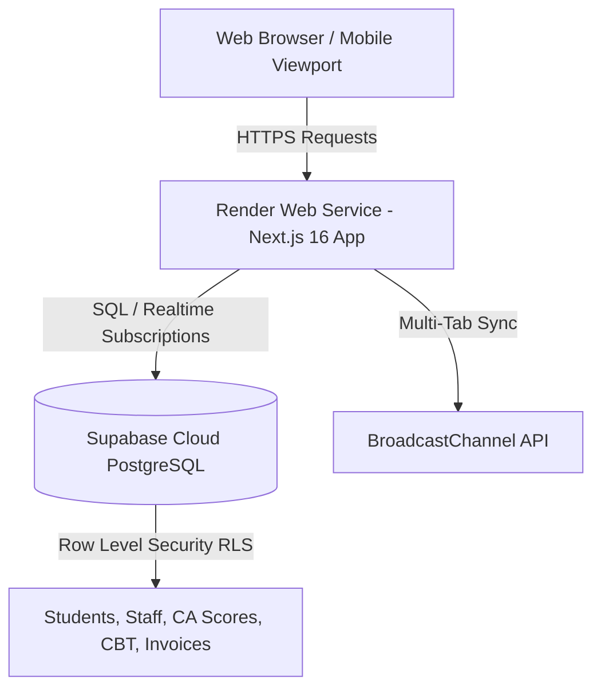

# 🚀 Serverless Cloud Deployment Guide: Render + Supabase

This guide outlines the exact, step-by-step procedure to deploy the **Royal Crown Academy School Management System (RCA SMS)** to **Supabase** (PostgreSQL Database, Realtime Subscriptions & RLS) and **Render** (Zero-Downtime Next.js Web Service).

---

## 🏛️ Architecture Overview



---

## 📋 Step 1: Set Up Supabase Cloud Database

1. **Create Account / Project**:
   - Go to [Supabase.com](https://supabase.com) and log in.
   - Click **"New project"**.
   - **Name:** `Royal Crown Academy SMS`
   - **Database Password:** Enter a secure password (store this safely).
   - **Region:** Select **Europe (Frankfurt)** or closest available region to Nigeria (e.g. `eu-central-1`).
   - Click **"Create new project"**.

2. **Execute Database Schema Migration**:
   - In your Supabase Dashboard, navigate to the **SQL Editor** (icon on the left sidebar).
   - Click **"New query"**.
   - Copy the entire contents of [`supabase/schema.sql`](supabase/schema.sql) and paste it into the query editor.
   - Click **"Run"**.
   - *Verification*: Go to the **Table Editor** to verify that tables (`students`, `staff`, `ca_scores`, `grading_tiers`, `cbt_questions`, `cbt_exam_sessions`, `invoices`, `transactions`, `audit_logs`, `inmail_messages`) have been created with Row Level Security (RLS) active.

3. **Harden Row Level Security (Important)**:
   - Open a new query in the **SQL Editor**.
   - Run [`supabase/harden-rls.sql`](supabase/harden-rls.sql). This removes the permissive "public read/write" policies that the old app relied on. Student, staff, and invoice data is then only reachable through the app's authenticated API routes.

4. **Give the service role its table privileges (do not skip this)**:
   - Open a new query in the **SQL Editor** and run:

     ```sql
     -- Every API route reads and writes Postgres as `service_role`. On this project those
     -- privileges had been revoked project-wide, so all four routes returned
     -- `permission denied for table …` while the RLS policies looked perfectly healthy.
     GRANT USAGE ON SCHEMA public TO service_role;
     GRANT ALL ON ALL TABLES IN SCHEMA public TO service_role;
     GRANT ALL ON ALL SEQUENCES IN SCHEMA public TO service_role;
     -- Default privileges apply only to tables created AFTER this runs, so re-run the
     -- three lines above whenever a migration adds a table. `anon` and `authenticated`
     -- are deliberately left with nothing: the browser never reads tables directly.
     ALTER DEFAULT PRIVILEGES IN SCHEMA public GRANT ALL ON TABLES TO service_role;
     ALTER DEFAULT PRIVILEGES IN SCHEMA public GRANT ALL ON SEQUENCES TO service_role;
     NOTIFY pgrst, 'reload schema';
     ```

   - *Verification*, and the diagnostic that tells you whether a future fault is privileges or RLS:

     ```sql
     SELECT r.rolname, r.rolbypassrls,
            has_table_privilege(r.rolname, 'public.students', 'SELECT')      AS can_read_students,
            has_table_privilege(r.rolname, 'public.app_accounts', 'INSERT')  AS can_write_app_accounts
     FROM pg_roles r WHERE r.rolname IN ('anon','authenticated','service_role');
     ```

     `service_role` should read `true / true / true`. An RLS-blocked `SELECT` returns an empty list;
     only a missing **GRANT** produces `42501 permission denied` — that distinction is what tells you
     not to go editing code. Note that privileges belong to the role, not to the key string, so
     **rotating an API key never requires re-running this step.**

5. **Run the four migrations the app's own screens need** (do not skip — this is the step that
   makes Settings, Publish Results, End of Term, Fee Structure, Invoicing, the Transactions
   ledger and the character assessment real instead of a browser-local performance). Open a new
   query for each file and run it in order; all four are idempotent, so re-running after an
   upgrade is safe:

   - [`supabase/app_accounts.sql`](supabase/app_accounts.sql) — the logins that Settings → User
     Access and *Register Staff* create. Until it runs, app-managed accounts cannot be created and
     User Access reports *Database not configured*.
   - [`supabase/guardian_students.sql`](supabase/guardian_students.sql) — which pupils a Parent
     login is allowed to see. Until it runs, every staff screen works but a parent's data calls
     fail with *The guardian link table could not be read*.
   - [`supabase/operations_state.sql`](supabase/operations_state.sql) — `school_config`,
     `result_publications`, `closed_terms`, `fee_components`, the receipt columns on
     `transactions`, and the `service_role` grants for all of them. Until it runs, those six
     screens answer *This part of the database is not set up on this project yet. Run
     supabase/operations_state.sql in the Supabase SQL editor, then try again.* (`503`). It ends
     with `SELECT`s you can run to prove each table is there.
   - [`supabase/traits_assessments.sql`](supabase/traits_assessments.sql) — `traits_config` (the
     school's one rubric, seeded with the fourteen default traits and never overwritten by a
     re-run) and `traits_assessments` (one row per pupil per session and term: the affective and
     psychomotor ratings, the attendance line, and the form-teacher, principal, next-term and
     promotion remarks). Until it runs, *Traits & Psychomotor*, *Setup → Traits* and `/api/traits`
     answer the same `503`, naming this file, and a family's card prints *No character assessment
     on file for this pupil.* The seed is `ON CONFLICT DO NOTHING`, so an edited rubric survives
     a re-run; ratings that were typed but never filed live only in that one browser.

6. **(Optional) Seed Official Baseline School Configuration**:
   - Open a new query in the **SQL Editor**.
   - Copy the contents of [`supabase/seed.sql`](supabase/seed.sql) and run it.
   - This sets up the 4 educational grading scales (*Pre-Play/Play*, *Nursery 1-2*, *Primary 1-5*, and *Secondary*). Login accounts are **not** stored in the database — they are provisioned with environment variables (see Step 2).

7. **Retrieve API Credentials**:
   - Navigate to **Project Settings** (gear icon) → **API Keys** → **Publishable / Secret keys**.
   - Copy:
     - **Project URL** (`https://<project-ref>.supabase.co`)
     - **Publishable key** — starts `sb_publishable_…` → `NEXT_PUBLIC_SUPABASE_ANON_KEY`
     - **Secret key** — starts `sb_secret_…` → `SUPABASE_SERVICE_ROLE_KEY`
   - The older `eyJhbGciOi…` JWTs (labelled *anon* and *service_role*) are a retired key generation.
     This project's legacy pair is **disabled**; a disabled legacy key makes every route answer `502`
     with `Legacy API keys are disabled`, which is the correct failure — it is loud, rather than
     quietly reading nothing.

---

## ☁️ Step 2: Deploy Next.js Web App to Render

### Option A: Declarative Blueprint Deployment (Recommended)
1. Push your repository to **GitHub** or **GitLab**.
2. Log into [Render.com](https://render.com).
3. Click **"New +"** → **"Blueprint"**.
4. Connect your `rca-sms-1` repository.
5. Render will automatically detect [`render.yaml`](render.yaml) and configure the web service.
6. When prompted, fill in the Environment Variables:
   - `NEXT_PUBLIC_SUPABASE_URL`: Your Supabase Project URL.
   - `NEXT_PUBLIC_SUPABASE_ANON_KEY`: Your Supabase Anon Key.
   - `SUPABASE_SERVICE_ROLE_KEY`: Your Supabase Service Role Key.
   - `AUTH_SUPER_ADMIN_PASSWORD`: A strong password for the `dominic370` super-admin account.
7. Click **"Apply"** to trigger automatic build and deployment.

### Option B: Manual Web Service Deployment
1. In Render, click **"New +"** → **"Web Service"**.
2. Connect your Git repository.
3. Configure the following build parameters:
   - **Name**: `rca-sms`
   - **Runtime**: `Node`
   - **Build Command**: `npm install && npm run build`
   - **Start Command**: `npm run start`
   - **Plan**: `Free`
4. In the **Environment Variables** section, add:
   | Key | Value | Description |
   |---|---|---|
   | `NODE_ENV` | `production` | Production mode |
   | `NEXT_PUBLIC_SUPABASE_URL` | `https://your-ref.supabase.co` | Supabase endpoint |
   | `NEXT_PUBLIC_SUPABASE_ANON_KEY` | `eyJhbGciOi...` | Supabase Anon Key |
   | `SUPABASE_SERVICE_ROLE_KEY` | `eyJhbGciOi...` | Supabase Service Role Key |
   | `AUTH_SESSION_SECRET` | *(Random 32+ char string)* | Signs login session cookies |
   | `AUTH_SUPER_ADMIN_USERNAME` | `dominic370` | Super-admin login username |
   | `AUTH_SUPER_ADMIN_PASSWORD` | *(strong password)* | Super-admin login password |
   | `AUTH_SUPER_ADMIN_NAME` / `AUTH_SUPER_ADMIN_STAFF_ID` / `AUTH_SUPER_ADMIN_EMAIL` | *(optional)* | Profile shown in the portal |
5. Click **"Create Web Service"**.

---

## 🛠️ Step 3: Initial Live Verification & Enrollment

Once your Render deployment is live at `https://rca-sms-1.onrender.com`:

1. **Verify Login & Role Access**:
   - Sign in at `/login` with the super-admin credentials you set (`AUTH_SUPER_ADMIN_USERNAME` / `AUTH_SUPER_ADMIN_PASSWORD`).
   - Confirm you land on the dashboard, then log out and confirm you are redirected back to `/login` when trying to visit any page directly.
   - Open **Settings → User Access** and create one login per remaining role (exam officer, teacher,
     accountant, parent, tester). Log in as each and confirm the menus differ. Environment accounts and
     database accounts both work; the environment account is the break-glass one and cannot be suspended
     from the app.
2. **Bulk Student Enrollment via CSV**:
   - Navigate to **Operations** → **Student Enrollment** ([`/operations/students`](http://localhost:3000/operations/students)).
   - Click **"Bulk Upload CSV"** and import your student roster across Pre-Play to Primary 5 & Secondary.
   - *This reaches the database* (`POST /api/students`, one upsert per pupil). Confirm it landed by
     reloading the page — a pupil that disappears on reload was never saved.
3. **Faculty Onboarding**:
   - Navigate to **Operations** → **Staff Management** ([`/operations/staff`](http://localhost:3000/operations/staff)).
   - Register one teacher with **Register Staff**. The portal creates the staff record and issues that
     person's login in the same request, then prints an access slip with the passcode — copy it before
     closing the slip, because it is shown once and stored nowhere in recoverable form.
   - **Do not use "Bulk Upload CSV" here yet.** `bulkAddStaff` still writes this browser's copy only;
     those teachers will not exist on another machine.
4. **Broadsheets & Reporting**:
   - Check the **Reports Hub** ([`/reports`](http://localhost:3000/reports)) to generate real-time broadsheet exports.
   - With `students` and `invoices` empty the hub is genuinely empty, and several figures on
     report cards are still placeholders invented in the browser. Confirm the source of every number
     before a report card is printed for a parent.

---

## 🎯 What is left before this is cloned for live

This deployment is the **test environment**. The order below is the order the work is done in, and it
is the order to re-verify after a clone. Each step's acceptance test is written so that it can be run
by someone who did not write the code.

| | Work | State in this repository | Acceptance test |
| --- | --- | --- | --- |
| **P0** | Backup job running green, keep-warm, branch protection, push approved fixes | Code and workflows are in; the **nightly backup is blocked until the five secrets exist**, the pinger interval is still undecided, and branch protection is a click in GitHub. | A nightly dump exists in the bucket and `pg_restore --list` opens it. |
| **P1** | No screen may print a figure nobody entered; no button may claim an action it did not perform | **Done in code**, for every screen: ungraded subjects print a dash, unassessed pupils open a blank form, CBT question banks start empty, invoices price themselves only from the filed fee schedule, and *Send SMS* / *Send Email* report what actually happened instead of claiming delivery. | Open a report card for a pupil with no stored marks and confirm it says *not entered* rather than showing numbers. |
| **P2** | School configuration gets a server: fees, the school's own name/session/term, publish flags, term closures, payment receipts, per-subject CA reads back, the trait rubric and the child's character assessment, cross-tab sync | **Mostly done, and honest about the rest.** Server-backed now: `school_config`, `fee_components`, receipts on `transactions`, `result_publications`, `closed_terms`, grading scales, CA marks, `traits_config` and `traits_assessments`. `supabase/operations_state.sql` **was run on this project and each of those routes was verified against it on 2026-11-05**; `supabase/traits_assessments.sql` still answers `503` until it is run. Still browser-only — each with a *Kept on this browser* notice: classes, subjects and packages, calendar, timetable, CA component structure, report theme and newsletter, CBT, Inmail. Ratings also stay on the form teacher's own machine until that screen's **File this class into the school's records** button is pressed. | Enter a setting on machine A, see it on machine B. |
| **P3** | Real roster enrolled, one real parent link, one mock term run end-to-end on the deployed site | Not started — `students` and `invoices` on this project are still empty. | Two browsers, same data, no fabricated numbers on the printed report. |
| **P4** | Features the school has asked for but not named yet | Not scoped. Ask before any of it is built; nothing here is a substitute for P2 and P3. | Planned after P3, not before. |

The full state of every screen — which ones reach Postgres and which ones are browser-only — is listed
under *Current limitations* in [README.md](README.md).

---

## 🔒 Security Best Practices for Production

- **Row Level Security (RLS)**: After running `schema.sql`, also run `supabase/harden-rls.sql` in the SQL Editor. This removes the permissive public policies; student/staff/invoice data then flows only through the app's authenticated API.
- **Service Role Key**: Keep `SUPABASE_SERVICE_ROLE_KEY` strictly in Render server-side environment variables; never prefix it with `NEXT_PUBLIC_`.
- **Session Secret**: `AUTH_SESSION_SECRET` must be a long random string. Anyone who knows it can forge login cookies.
- **Automatic HTTPS**: Render automatically provisions and renews SSL/TLS certificates for your custom domain (e.g., `portal.royalcrownacademy.edu.ng`).
- **Backups are yours to run.** A free Supabase project keeps no copy of anything, so
  `nightly-backup.yml` is the only thing between a bad afternoon and a lost term. It fails rather than
  skipping, and a dump is a full copy of every child's record: private bucket, never the repository.
- **Keep-warm and the pinger are two different problems.** `keep-warm.yml` every six hours stops the
  *database* pausing (7 quiet days). Only a 4–5 minute ping stops the *web service* sleeping
  (15 idle minutes). Decide which of the three options in README.md you want before the term opens.
- **No plaintext passwords, anywhere.** `app_accounts` stores a salted scrypt hash; the generated
  passcode exists only on the access slip shown once. A "permanent record of login details" — in
  InMail, a table, or a spreadsheet — is the same leak as the one already closed, so it is
  deliberately not implemented.
- **Never commit `.env.local`**, and never paste a key into a chat, an issue, or a workflow file.
  Keys belong in Render environment variables and GitHub Actions secrets.
