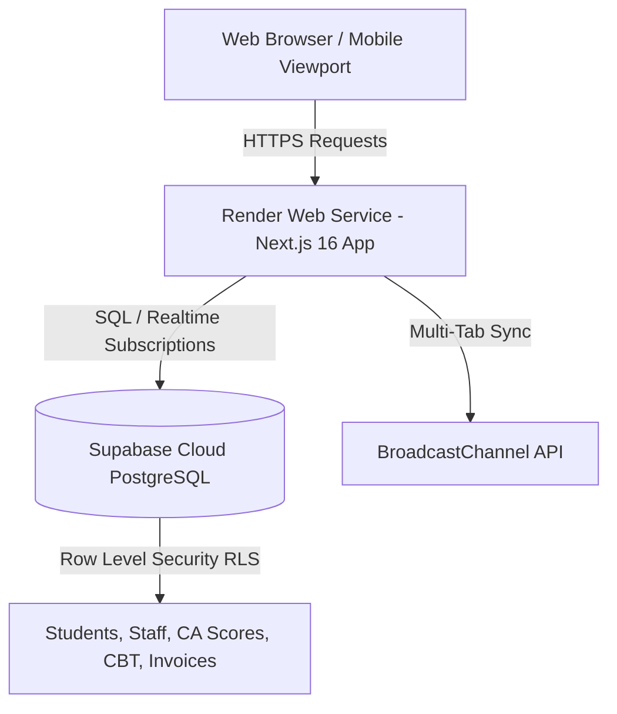

# 🚀 Serverless Cloud Deployment Guide: Render + Supabase

This guide outlines the exact, step-by-step procedure to deploy the **Royal Crown Academy School Management System (RCA SMS)** to **Supabase** (PostgreSQL Database, Realtime Subscriptions & RLS) and **Render** (Zero-Downtime Next.js Web Service).

---

## 🏛️ Architecture Overview

---

## 📋 Step 1: Set Up Supabase Cloud Database

1. **Create Account / Project**:
   - Go to [Supabase.com](https://supabase.com) and log in.
   - Click **"New project"**.
   - **Name:** `Royal Crown Academy SMS`
   - **Database Password:** Enter a secure password (store this safely).
   - **Region:** Select **Europe (Frankfurt)** or closest available region to Nigeria (e.g. `eu-central-1`).
   - Click **"Create new project"**.

2. **Execute Database Schema Migration**:
   - In your Supabase Dashboard, navigate to the **SQL Editor** (icon on the left sidebar).
   - Click **"New query"**.
   - Copy the entire contents of [`supabase/schema.sql`](supabase/schema.sql) and paste it into the query editor.
   - Click **"Run"**.
   - *Verification*: Go to the **Table Editor** to verify that tables (`students`, `staff`, `ca_scores`, `grading_tiers`, `cbt_questions`, `cbt_exam_sessions`, `invoices`, `transactions`, `audit_logs`, `inmail_messages`) have been created with Row Level Security (RLS) active.

3. **Harden Row Level Security (Important)**:
   - Open a new query in the **SQL Editor**.
   - Run [`supabase/harden-rls.sql`](supabase/harden-rls.sql). This removes the permissive "public read/write" policies that the old app relied on. Student, staff, and invoice data is then only reachable through the app's authenticated API routes.

4. **(Optional) Seed Official Baseline School Configuration**:
   - Open a new query in the **SQL Editor**.
   - Copy the contents of [`supabase/seed.sql`](supabase/seed.sql) and run it.
   - This sets up the 4 educational grading scales (*Pre-Play/Play*, *Nursery 1-2*, *Primary 1-5*, and *Secondary*). Login accounts are **not** stored in the database — they are provisioned with environment variables (see Step 2).

5. **Retrieve API Credentials**:
   - Navigate to **Project Settings** (gear icon) → **API**.
   - Copy:
     - **Project URL** (`https://<project-ref>.supabase.co`)
     - **anon / public key** (`eyJhbGciOi...`)
     - **service_role key** (secret key for server operations)

---

## ☁️ Step 2: Deploy Next.js Web App to Render

### Option A: Declarative Blueprint Deployment (Recommended)
1. Push your repository to **GitHub** or **GitLab**.
2. Log into [Render.com](https://render.com).
3. Click **"New +"** → **"Blueprint"**.
4. Connect your `rca-sms-1` repository.
5. Render will automatically detect [`render.yaml`](render.yaml) and configure the web service.
6. When prompted, fill in the Environment Variables:
   - `NEXT_PUBLIC_SUPABASE_URL`: Your Supabase Project URL.
   - `NEXT_PUBLIC_SUPABASE_ANON_KEY`: Your Supabase Anon Key.
   - `SUPABASE_SERVICE_ROLE_KEY`: Your Supabase Service Role Key.
   - `AUTH_SUPER_ADMIN_PASSWORD`: A strong password for the `dominic370` super-admin account.
7. Click **"Apply"** to trigger automatic build and deployment.

### Option B: Manual Web Service Deployment
1. In Render, click **"New +"** → **"Web Service"**.
2. Connect your Git repository.
3. Configure the following build parameters:
   - **Name**: `rca-sms`
   - **Runtime**: `Node`
   - **Build Command**: `npm install && npm run build`
   - **Start Command**: `npm run start`
   - **Plan**: `Free`
4. In the **Environment Variables** section, add:
   | Key | Value | Description |
   |---|---|---|
   | `NODE_ENV` | `production` | Production mode |
   | `NEXT_PUBLIC_SUPABASE_URL` | `https://your-ref.supabase.co` | Supabase endpoint |
   | `NEXT_PUBLIC_SUPABASE_ANON_KEY` | `eyJhbGciOi...` | Supabase Anon Key |
   | `SUPABASE_SERVICE_ROLE_KEY` | `eyJhbGciOi...` | Supabase Service Role Key |
   | `AUTH_SESSION_SECRET` | *(Random 32+ char string)* | Signs login session cookies |
   | `AUTH_SUPER_ADMIN_USERNAME` | `dominic370` | Super-admin login username |
   | `AUTH_SUPER_ADMIN_PASSWORD` | *(strong password)* | Super-admin login password |
   | `AUTH_SUPER_ADMIN_NAME` / `AUTH_SUPER_ADMIN_STAFF_ID` / `AUTH_SUPER_ADMIN_EMAIL` | *(optional)* | Profile shown in the portal |
5. Click **"Create Web Service"**.

---

## 🛠️ Step 3: Initial Live Verification & Enrollment

Once your Render deployment is live at `https://rca-sms.onrender.com`:

1. **Verify Login & Role Access**:
   - Sign in at `/login` with the super-admin credentials you set (`AUTH_SUPER_ADMIN_USERNAME` / `AUTH_SUPER_ADMIN_PASSWORD`).
   - Confirm you land on the dashboard, then log out and confirm you are redirected back to `/login` when trying to visit any page directly.
   - Each role (exam officer, teacher, accountant, parent) has its own username/password pair — log in with each to verify the correct menus appear.
2. **Bulk Student Enrollment via CSV**:
   - Navigate to **Operations** → **Student Enrollment** ([`/operations/students`](http://localhost:3000/operations/students)).
   - Click **"Bulk Upload CSV"** and import your student roster across Pre-Play to Primary 5 & Secondary.
3. **Faculty Onboarding via CSV**:
   - Navigate to **Operations** → **Staff Management** ([`/operations/staff`](http://localhost:3000/operations/staff)).
   - Click **"Bulk Upload CSV"** to onboard teachers and form masters.
4. **Broadsheets & Reporting**:
   - Check the **Reports Hub** ([`/reports`](http://localhost:3000/reports)) to generate real-time broadsheet exports.

---

## 🔒 Security Best Practices for Production

- **Row Level Security (RLS)**: After running `schema.sql`, also run `supabase/harden-rls.sql` in the SQL Editor. This removes the permissive public policies; student/staff/invoice data then flows only through the app's authenticated API.
- **Service Role Key**: Keep `SUPABASE_SERVICE_ROLE_KEY` strictly in Render server-side environment variables; never prefix it with `NEXT_PUBLIC_`.
- **Session Secret**: `AUTH_SESSION_SECRET` must be a long random string. Anyone who knows it can forge login cookies.
- **Automatic HTTPS**: Render automatically provisions and renews SSL/TLS certificates for your custom domain (e.g., `portal.royalcrownacademy.edu.ng`).
